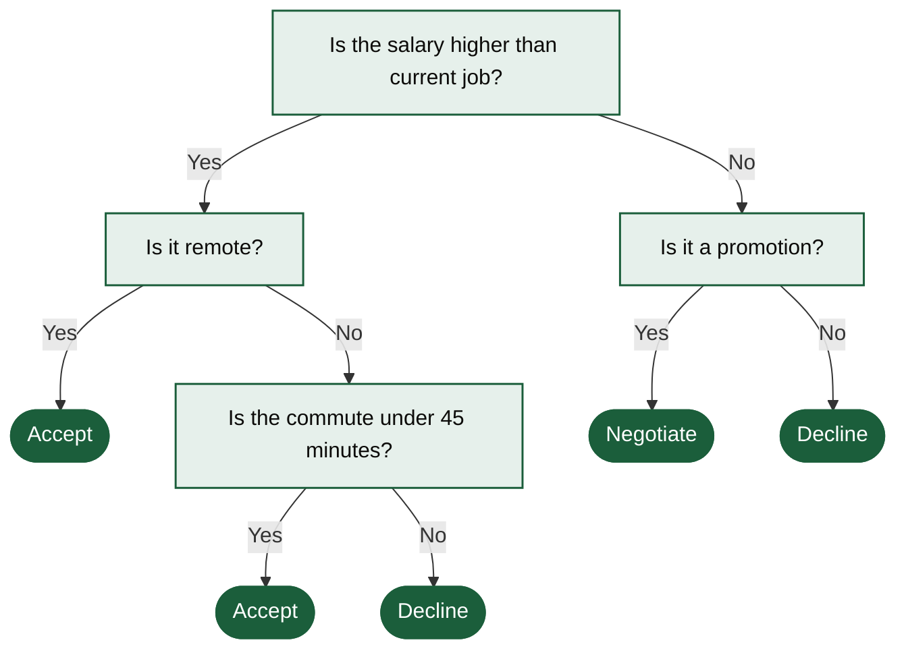

# Job Offer Decision Tree



A decision tree for a job offer, where salary, remote work, commute and promotion lead to accept, negotiate or decline. A plain yes/no tree that reads from top to bottom.

## Input text

```text
Should I accept the job offer? If the salary is higher than my current job, check whether it is remote. Remote: accept. Not remote: accept only if the commute is under 45 minutes, otherwise decline. If the salary is not higher, decline, unless the role is a promotion; then negotiate the salary.
```

The text is in [source.txt](source.txt) and the diagram source in [diagram.mmd](diagram.mmd). Made with the [Decision Tree Generator](https://www.eidora.io/tools/decision-tree-generator).
