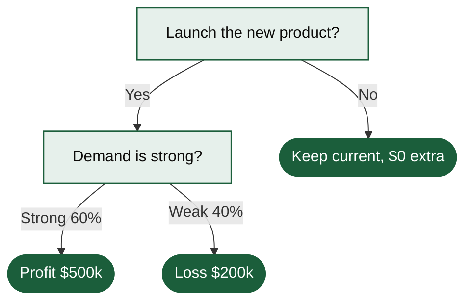

# Product Launch Decision Tree



A decision tree with probabilities and payoffs: launch with a 60% chance of $500k profit and a 40% chance of $200k loss, or keep the current line. The numbers are shown as given and are not calculated.

## Input text

```text
Should we launch the new product? If we launch, there is a 60% chance of strong demand (profit $500k) and a 40% chance of weak demand (loss $200k). If we do not launch, we keep the current product line and make $0 extra.
```

The text is in [source.txt](source.txt) and the diagram source in [diagram.mmd](diagram.mmd). Made with the [Decision Tree Generator](https://www.eidora.io/tools/decision-tree-generator).
