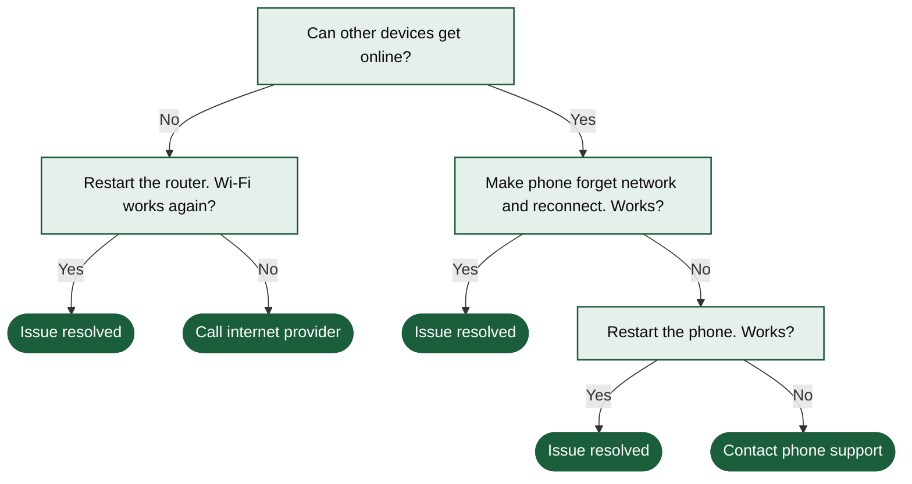

# Wi-Fi Troubleshooting Decision Tree



A troubleshooting tree for a phone that will not connect to Wi-Fi, from checking other devices to contacting support. Suits help-center articles and support scripts.

## Input text

```text
Phone will not connect to Wi-Fi. Can other devices get online? If not, restart the router: if the Wi-Fi works again, you are done; if not, call the internet provider. If other devices are online, make the phone forget the network and reconnect: if it works, you are done; if not, restart the phone, and if that does not help either, contact the phone maker's support.
```

The text is in [source.txt](source.txt) and the diagram source in [diagram.mmd](diagram.mmd). Made with the [Decision Tree Generator](https://www.eidora.io/tools/decision-tree-generator).
