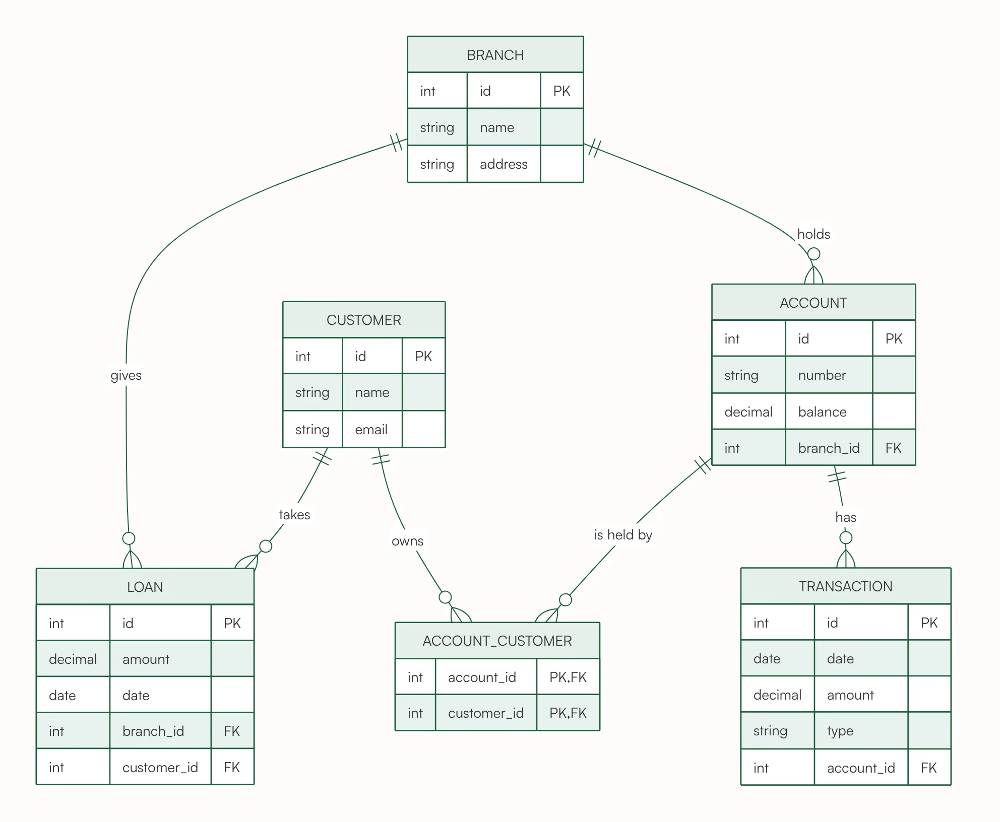

# Bank ER Diagram With Joint Accounts



A bank with branches, customers, accounts, transactions and loans, including joint accounts through an ACCOUNT_CUSTOMER table whose primary key is the pair of ids. It shows a composite key that is also a pair of foreign keys. Useful for finance-themed course projects.

## Input text

```text
Bank database: each branch holds many accounts and gives out loans. A customer can have several accounts, and an account can be held by more than one customer (joint accounts). Each account has many transactions (date, amount, type). Each loan is taken by one customer from one branch.
```

The same text is in [source.txt](source.txt). Made with the [ER Diagram Generator](https://www.eidora.io/tools/er-diagram-generator).
