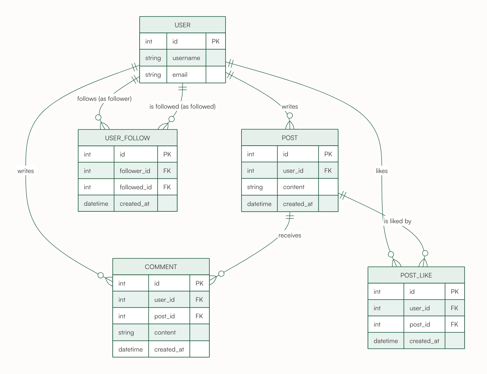

# Social Media App ER Diagram



Users, posts, comments, likes and follows. Likes are many-to-many between users and posts, and USER_FOLLOW links the USER entity to itself. It shows a self-referencing many-to-many relationship.

## Input text

```text
Social media app: users write posts, users comment on posts, users like posts, and users follow other users.
```

The same text is in [source.txt](source.txt). Made with the [ER Diagram Generator](https://www.eidora.io/tools/er-diagram-generator).
