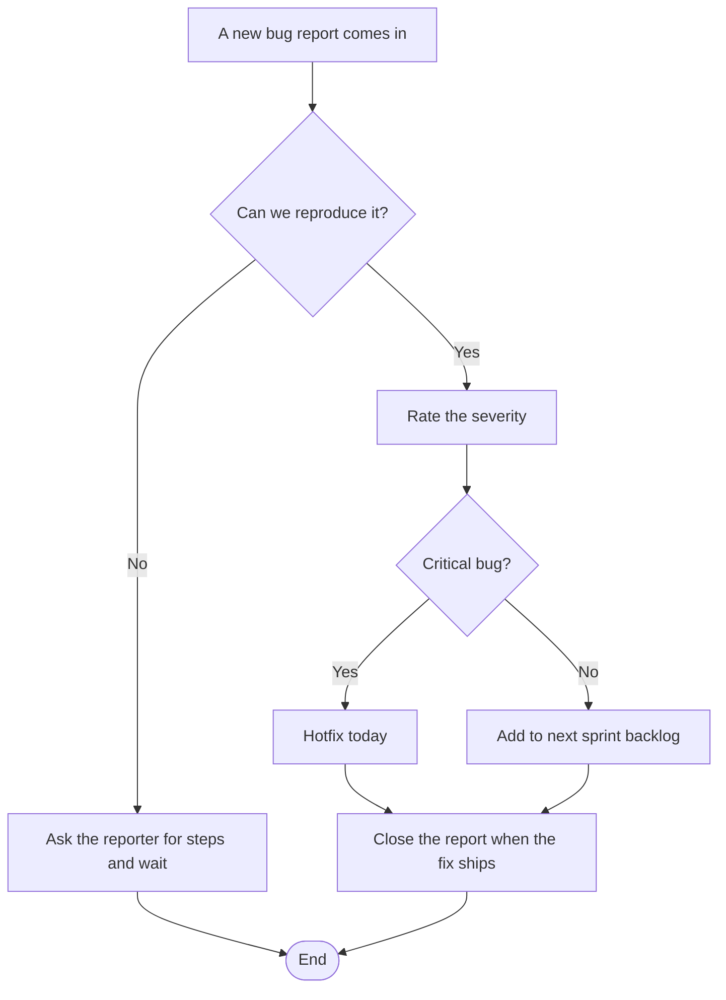

# Bug Triage Flowchart



A bug triage flow from report to fix: try to reproduce, rate the severity, hotfix or backlog, then close the report. Fits engineering process documents.

## Input text

```text
Bug triage: a new bug report comes in. Can we reproduce it? If not, ask the reporter for steps and wait. If yes, rate the severity. Critical bugs get a hotfix today; the rest go to the next sprint backlog. Close the report when the fix ships.
```

The text is in [source.txt](source.txt) and the diagram source in [diagram.mmd](diagram.mmd). Made with the [Flowchart Generator](https://www.eidora.io/tools/ai-flowchart-generator).
