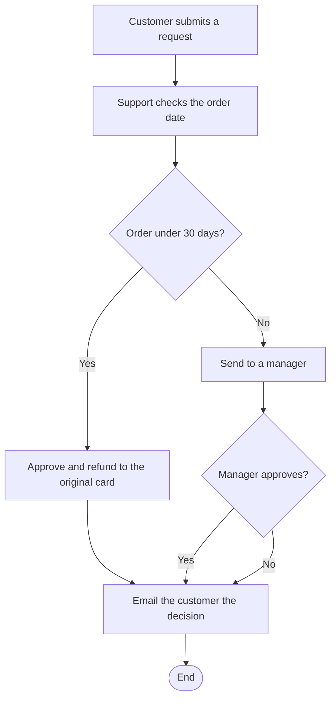

# Refund Request Flowchart



A refund process that approves orders under 30 days and sends older ones to a manager, with an email to the customer either way. It shows branching with a shared final step. Fits support and operations handbooks.

## Input text

```text
Refund request: the customer submits a request and support checks the order date. Under 30 days: approve and refund to the original card. Over 30 days: send to a manager, who approves or declines with a reason. Email the customer the decision either way.
```

The text is in [source.txt](source.txt) and the diagram source in [diagram.mmd](diagram.mmd). Made with the [Flowchart Generator](https://www.eidora.io/tools/ai-flowchart-generator).
