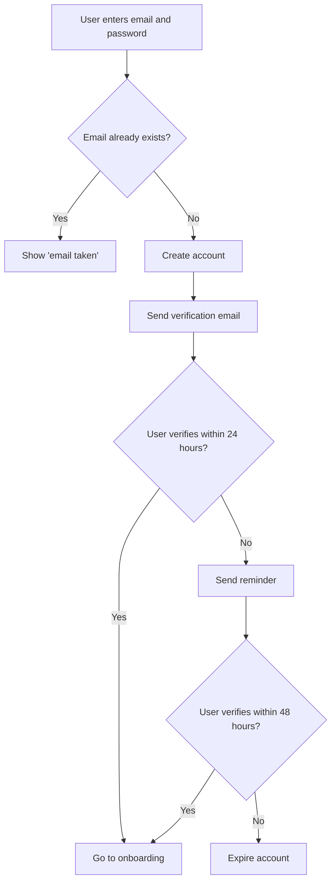

# Signup Flowchart



A signup flow: email and password, a duplicate-email check, a verification email, and then onboarding or a reminder and expiry. Useful for documenting registration logic. GitHub renders the diagram from the Mermaid source below.

## Input text

```text
User signup: the user enters an email and password. If the email already exists, show "email taken". Otherwise create the account and send a verification email. If the user verifies within 24 hours, go to onboarding; if not, send a reminder, and expire the account after 48 hours.
```

The text is in [source.txt](source.txt) and the diagram source in [diagram.mmd](diagram.mmd). Made with the [Flowchart Generator](https://www.eidora.io/tools/ai-flowchart-generator).
