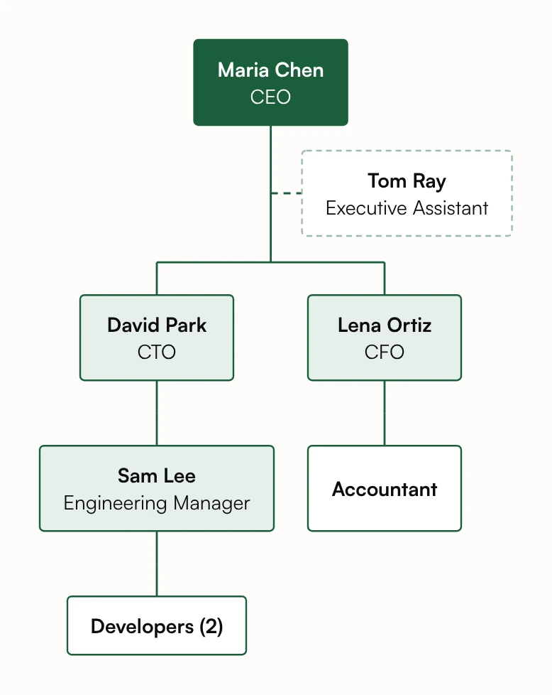

# Startup Org Chart



A shallow startup chart: the CTO and CFO report to the CEO, an engineering manager leads the developers, and the executive assistant is joined by a dashed line beside the team. Easy to regenerate by adding one sentence when someone joins. The names are fictional.

## Input text

```text
Our startup: Maria Chen is the CEO. David Park (CTO) and Lena Ortiz (CFO) report to her, and Tom Ray is her executive assistant. Sam Lee, an engineering manager, reports to David and leads two developers. An accountant reports to Lena.
```

The same text is in [source.txt](source.txt). Made with the [Org Chart Generator](https://www.eidora.io/tools/org-chart-generator).
