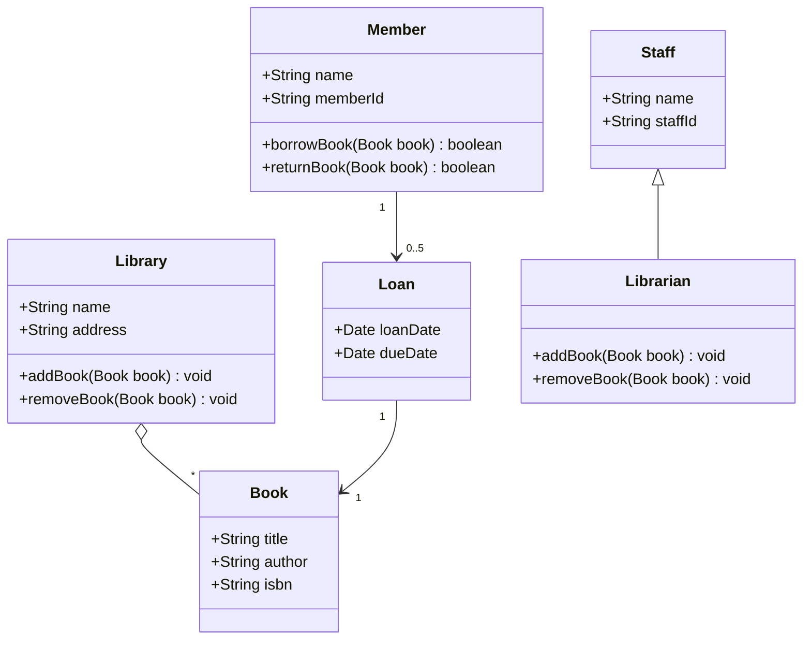

# Library Class Diagram



A UML class diagram for a library: Library, Book, Member, Loan, Staff and Librarian, with attributes, methods, multiplicities and one inheritance link. Use it as a draft for object-oriented design.

## Input text

```text
Library system class diagram: a Library holds many Books. A Book has a title, author and ISBN. A Member has a name and member ID and can borrow up to 5 books at a time; each Loan records one member, one book, the loan date and the due date. A Librarian is a kind of Staff and can add or remove books.
```

The text is in [source.txt](source.txt) and the diagram source in [diagram.mmd](diagram.mmd). Made with the [UML Diagram Generator](https://www.eidora.io/tools/uml-diagram-generator).
