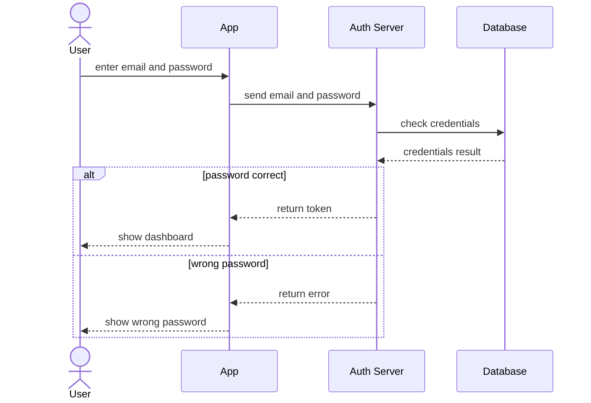

# Login Sequence Diagram



A UML sequence diagram of a login between a user, an app, an auth server and a database, with a branch for a correct password and one for a wrong password. Fits API and authentication documentation.

## Input text

```text
Sequence diagram for login: the user enters email and password in the app, the app sends them to the auth server, and the auth server checks the database. If the password is right, it returns a token and the app shows the dashboard; if not, it returns an error and the app shows "wrong password".
```

The text is in [source.txt](source.txt) and the diagram source in [diagram.mmd](diagram.mmd). Made with the [UML Diagram Generator](https://www.eidora.io/tools/uml-diagram-generator).
