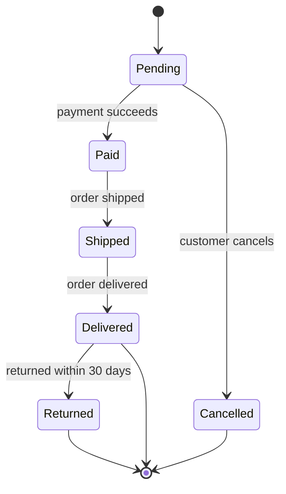

# Order State Diagram



A UML state diagram of an online order from pending to delivered, cancelled or returned within 30 days. Fits order-management specifications.

## Input text

```text
State diagram for an online order: it starts as Pending, becomes Paid when payment succeeds, or Cancelled if the customer cancels. Paid orders are Shipped, then Delivered. A delivered order can be Returned within 30 days.
```

The text is in [source.txt](source.txt) and the diagram source in [diagram.mmd](diagram.mmd). Made with the [UML Diagram Generator](https://www.eidora.io/tools/uml-diagram-generator).
