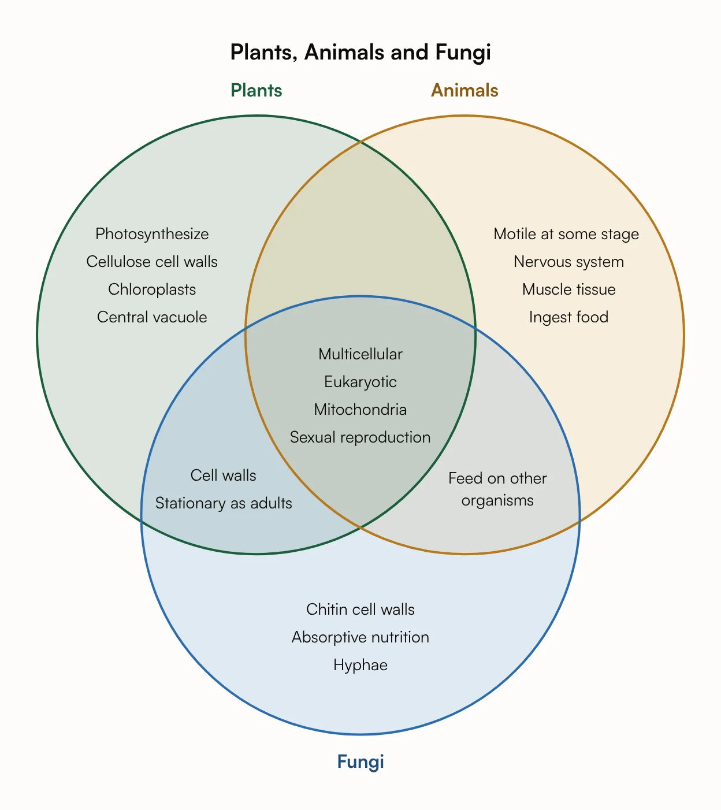

# Plants, Animals and Fungi: a Three-Circle Venn Diagram



A three-circle Venn diagram of plants, animals and fungi, with seven regions. The pairs carry the lesson: plants and fungi both have cell walls, and animals and fungi both feed on other organisms. The empty plants-and-animals region is part of the answer.

## Input text

```text
Venn diagram of plants, animals and fungi
```

The same text is in [source.txt](source.txt). Made with the [Venn Diagram Maker](https://www.eidora.io/tools/venn-diagram-maker).
